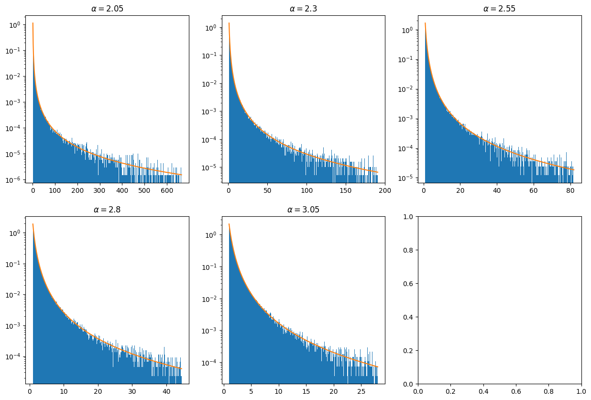

# Statistical Physics in Python

Stochastic methods I implemented in Python (NumPy, SciPy, Matplotlib) for the Statistical Physics course of the
Engineering Physics degree at the Faculty of Sciences, University of Porto (FCUP).

The notebooks are in Portuguese; problem statements are summarised in English at the top of each section.



## Contents

| Notebook | What it does |
|---|---|
| [`01-heavy-tailed-distributions`](01-heavy-tailed-distributions.ipynb) | Sampling a power-law distribution with the inversion method (Newton–Raphson) and von Neumann rejection sampling with exponential and Pareto proposals; acceptance-rate analysis; distribution of the sample mean when the variance is infinite, where the central limit theorem fails, and an empirical scaling collapse |
| [`02-markov-chains-in-a-potential`](02-markov-chains-in-a-potential.ipynb) | Markov transition matrix for a particle hopping in a harmonic potential with Metropolis acceptance; time evolution by matrix powers and by eigen-decomposition; equilibrium distribution vs. Boltzmann; equilibration time as a function of hop size and temperature; effect of a central potential barrier |

## Running

```bash
pip install -r requirements.txt
jupyter notebook
```

Some cells build 513×513 transition matrices with plain Python loops or draw 2²⁰ random samples, so they can take
a minute to run.
